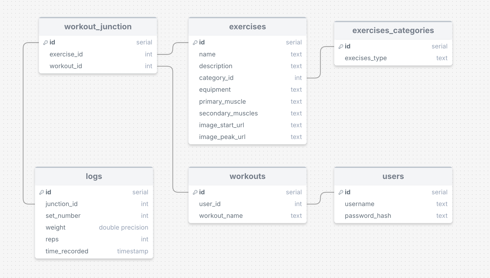

# workout_app_v2
Workout app written in Go

# SQL schema

# Database preparation
Before running the script login to your postgres database and execute these two commands:
1. Create a new user with a password `CREATE USER workout_app_user WITH PASSWORD 'your_secure_password';`
2. Create the database and assign ownership to the new user `CREATE DATABASE workout_app_db OWNER workout_app_user;`
